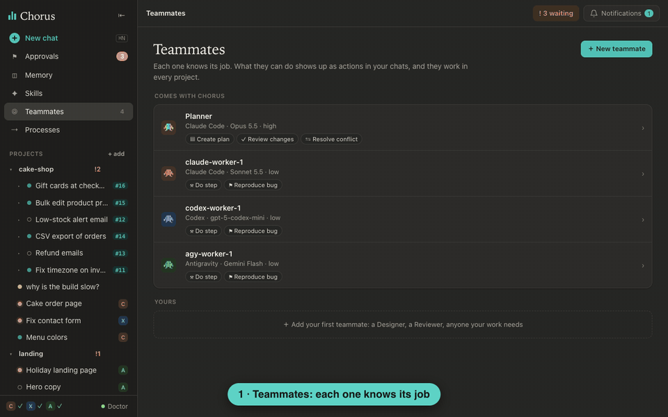
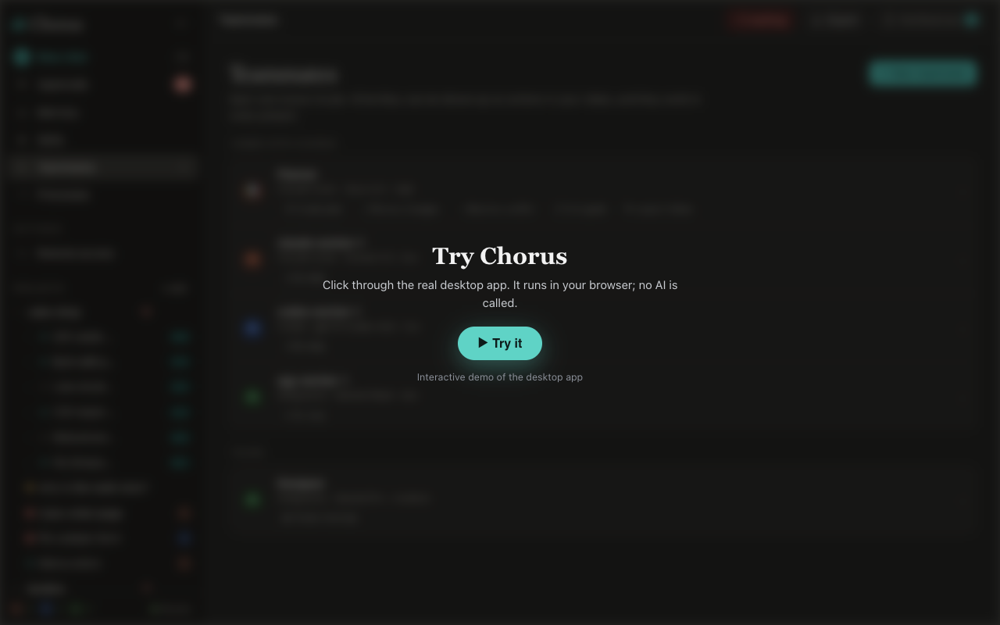

# 🎵 Chorus

**We're building the best place to work with AI.**<br>
Any AI you choose. All your work in one place. Grows with you. Always yours.

**Website: [chorus-cli.web.app](https://chorus-cli.web.app/)**

- **The real CLI, untouched.** Claude Code, Codex and Antigravity run as themselves, with every command, shortcut and feature you know. You keep working the way you already do; Chorus adds what's around it.
- **No more ten terminal windows.** Every session sits in one sidebar.
- **No more tab-hopping to catch approvals.** The agent that's waiting comes to you.
- **Think with the strongest model, build with a cheap one.** Plan on maximum effort, then hand the build to a faster model that costs less.
- **Never start from zero.** When a plan limit hits, another agent picks up where the first one stopped.
- **Run your work, not your windows.** Projects, goals and tasks show what's planned, what's moving and what's done.
- **Agents that learn from mistakes.** When something fails, Chorus records what went wrong, so the next agent doesn't repeat it.
- **One memory, one set of skills.** What one agent learns, every agent knows.



### Try it in your browser

Pick what you want to see: plan and run a task, hand off a chat, build your team or watch a project. A few clicks each, and the app points at every one. No install, no AI called.

[](https://chorus-cli.web.app/try/)

## Handoff: switch agents without losing anything

**When**
- **Your plan limit hits mid-task.** Hand off and keep going. The context comes from Chorus, not from the agent that stopped.
- **You want a second opinion.** Let another model review what this one built.
- **You want the right model for each step.** Plan with the strongest model, then hand the build to a cheaper, faster one.

**Why.** No more copy-pasting context or explaining the task again. The new agent starts out knowing what was asked, what was decided, which files changed, what the tests said, and what's still open.

**How.** Click **⇄ Hand off** in any chat and pick who goes on:
- **A teammate.** It can take over the chat, or run one of its actions (Create plan, Review changes...) in a linked thread while your chat goes on.
- **Any AI model on its own.** Claude Code, Codex or Antigravity, with no teammate and no instructions: it just takes over.

Either way the new thread loads the chat's record through the Chorus MCP server, sums up what it learned, and waits for your OK. The old chat stays as it was; switch back anytime.

## Your process: define how work gets done, then let it run

You set up your way of working once: **who** does the work (teammates), **what** each one knows how to do (actions), and **what comes next** after each job (the process). Then you plan a task, and the process carries it from step to step on its own.

- **Teammate:** instructions + an agent + a model and effort + skills + permissions + actions. The **Planner** and one **Worker** per installed CLI come with Chorus; add your own (a Designer, a Reviewer, anyone your work needs).
- **Action:** a job a teammate knows how to do: its instructions, **what happens next**, and whether it asks you first. Most are a button in every chat; some start by themselves, like *Resolve conflict*.
- **Process:** the chain you get by following "what happens next". Each link is a handoff: the next teammate starts from the record of the work before it (the goal, what was decided, what changed, what's left), so it always has enough context to begin. Nothing to configure: change an action and the process follows.

  `Planner: Create plan → you approve → Workers: Do step → Planner: Review changes → you accept`
- **Task:** what a process works on. The Planner turns your request into a task with steps (how to do each, how to check it), then each step goes to a Worker in its own work session, handed from teammate to teammate. You only step in where an action asks you to.

## Projects: you steer, your agents grow

Each project folder gets a **Portal**: one page that answers *what needs me?* and *are we on track?*

- **Needs you:** every question, plan to approve and piece of work to check, from every agent, in one list.
- **Board:** each task moves on its own through Planning → Ready → Doing → To check → Done, live while the agents work. Open a task for what it is, when it counts as done, and every chat that worked on it.
- **Goals:** what a group of tasks is for, with its progress. Name one yourself, or let the Planner group the tasks and ask you before it creates a goal.
- **Failures:** when you deny a request, send work back or reject a plan, Chorus records what went wrong and a lesson to learn from it. One click **teaches the teammate** (the lesson goes into its instructions), **adds it to project memory**, or **makes it a task**. The next agent starts from what the last one got wrong, so your team gets better the more you use it.

## Install

Chorus is a desktop app (macOS and Linux) with the `chorus` command. The window runs `chorus serve` and shows every
thread, tool call, approval and artifact; the agents themselves stay the real CLIs.

The website ([chorus-cli.web.app](https://chorus-cli.web.app/)) has the downloads and the install script. Needs at least one of `claude`, `codex`, `agy` installed and logged in (`chorus doctor` checks).

```bash
curl -fsSL https://chorus-cli.web.app/install.sh | sh                        # production
curl -fsSL https://chorus-cli.web.app/install.sh | bash -s -- --preview      # newest preview
curl -fsSL https://chorus-cli.web.app/docker.sh | bash                       # in a Docker box, in your browser (macOS, Linux)
irm https://chorus-cli.web.app/docker.ps1 | iex                              # in a Docker box on Windows (PowerShell)
```

`chorus` opens the desktop app and prints the address of the same Chorus in a browser. With no screen (a container, SSH, a
server) it runs Chorus for a browser and prints the address; `chorus serve --host 0.0.0.0` lets another computer reach it.
`chorus-cli` opens the terminal app (on hold, see Contributing). The Docker box: [docs/features/docker-box.md](docs/features/docker-box.md).

## Use it

```bash
chorus                                                          # the desktop app
chorus new --agent claude --model sonnet --folder ~/work/api    # a thread without the form
chorus handoff --to codex                                       # continue the latest thread in Codex
chorus doctor | threads | show <id> | memory <id> | activity | trace <id>
chorus artifacts --serve --open                                 # artifacts in the browser, live reload
chorus-cli                                                      # the terminal app
```

In the terminal app the menu key is `Ctrl+\` (`CHORUS_MENU_KEY=ctrl+b` picks another), then one letter: `n` new thread ·
`h` hand off · `1-9` switch · `m` memory · `a` artifacts · `e` activity · `y`/`x` approve/deny · `0` home · `?` help · `q` quit.

## Contributing

Chorus is AGPL-3.0 and developed in the open. Needs Node 22+; clone `chorus` and its private sibling `chorus-core` (the CLI
integration library) side by side, because `package.json` depends on `file:../chorus-core`; build that first.

```bash
npm install
npm test                  # contract + flow tests, no login needed
npm run typecheck
node src/cli/index.ts serve --open --fake-agents     # the desktop page without model calls
npm run proof:desktop     # end-to-end with the real CLIs (needs them logged in)
```

**Git flow.** `main` (preview releases) ← `dev` ← `feature/<slug>` | `fix/<slug>`; a `hotfix/<slug>` starts from a
production tag. Use Conventional Commits (`feat:`, `fix:`, `docs:`...), since the version is computed from them. Never work
directly on `dev` or `main`; open a PR into `dev`. Every bug fix comes with a regression test that failed before the fix.

**Rules that keep the app honest.**
1. Verify against the real CLIs. Never build on an assumed flag, event or file path: capture it with `tools/probe`, commit
   the fixture, then write the code.
2. Never edit the user's global CLI config; use per-session flags.
3. When spawning a CLI, close stdin for headless runs and remove `CLAUDECODE`, `CLAUDE_CODE_SESSION_ID`,
   `CLAUDE_CODE_CHILD_SESSION`, `CLAUDE_PID` from its environment.
4. Review fixtures for personal data before committing (the probe redacts emails, account ids and the home path).
5. The desktop app (`src/serve/`, `src/desktop/`, `desktop/`) comes first; the terminal app (`src/app/`) is on hold, so
   leave it alone unless a maintainer says otherwise.
6. This repo is public: no business material (pricing, plans, competitors) in code, docs or commits.

**Working with an AI coding agent.** Point it at this README and [docs/map.md](docs/map.md) (every doc, and where plans,
failures and learnings go). Example prompts:

- "Read README.md and docs/map.md, then fix <issue>. Branch from dev, add a failing regression test first."
- "Add <feature> to the desktop page. Verify against the real CLIs and save a screenshot as proof."

AI agent instruction files (`AGENTS.md`, `CLAUDE.md`) are not part of this repository; keep your own local copies, they are
git-ignored.

**Releases.** A merge into `main` is followed by a tag `vX.Y.Z-preview.N`, which `.github/workflows/release.yml` builds as
the rolling prerelease `preview`. A production tag `vX.Y.Z` is cut by the maintainer on the commit of a tested preview; it
builds the downloads attached to the GitHub Release. The website and `install.sh` live in a separate repository.

Build setup (repository settings): the secret `CHORUS_CORE_DEPLOY_KEY` is a read-only deploy key of the private chorus-core,
which the workflow checks out next to this repo (only the core's built `dist/` goes into the downloads); the optional variable
`CHORUS_CORE_REF` is the chorus-core branch or tag to bundle (`dev` when unset). `npm run release:downloads` builds the same
files on a Mac (needs Docker and the Tauri toolchain); `npm run release:fetch` pulls a release into the website repository.

## Docs

| Doc | What's in it |
|---|---|
| [docs/map.md](docs/map.md) | Start here: every doc, and where new plans, features, failures and releases go |
| [docs/architecture.md](docs/architecture.md) | Build plan (5 phases), components, what is stored, MCP tools, handoff |
| [docs/roadmap.md](docs/roadmap.md) | Progress per phase and open technical debt |
| [docs/testing.md](docs/testing.md) | Test layers, what runs in the cloud vs on your Mac |
| [docs/phase5.md](docs/phase5.md) | The desktop app |
| [docs/integrations/](docs/integrations/README.md) | Verified facts per CLI: flags, events, paths, token usage, gotchas |

## Repository layout

```
src/core/        adapters, store, handoff, skills sync, launch (TypeScript, Node 22+, no build step: node file.ts)
src/serve/       chorus serve: local API + agent screens over WebSocket
src/desktop/     the desktop page it serves
desktop/         the native window: a thin Tauri shell that starts chorus serve
src/mcp/, src/cli/   the chorus MCP server and the chorus entry point
src/app/         the terminal app (on hold)
docs/            architecture, roadmap, testing, per-CLI integration docs
tools/probe/     capability probe: runs a real CLI through fixed scenarios, records fixtures
fixtures/        captured real CLI output, per CLI and version (used by contract tests)
test/            contract/, flow/, app/, serve/, smoke/
```

```bash
node tools/probe/probe.mjs claude --model haiku    # recapture fixtures; also codex, agy
```

## Licence

GNU AGPL version 3 only ([LICENSE](LICENSE)), with an additional permission to combine Chorus with its CLI integration
library `@chauvoluuhuong/chorus-core`, which has its own licence. See [NOTICE.md](NOTICE.md).
