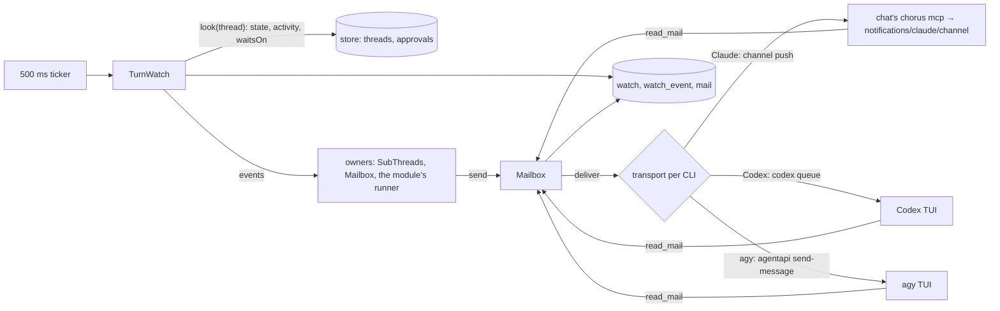

# One watcher and one mailbox: what chorus serve does

Task #10 (2026-11-18). Chorus no longer types its messages into a chat's input, and an action no longer ends only when the model
remembers to say so. Two free engines from chorus-core do that work, and `chorus serve` runs exactly one of each:

- **TurnWatch** (chorus-core `src/watch/`): the only code that looks at chats over time.
- **Mailbox** (chorus-core `src/mail/`): every message between chats, and from Chorus to a chat, as a record delivered through one
  transport per CLI.

How the engines work is in chorus-core's `docs/watch-and-mail.md`; this page is the host's side. The optional module gets the same
two instances as `ProCtx.watch` and `ProCtx.mail` (an older host without them makes its own, ticked every 2 s).

## Relations

| Relation | Watch key | What is expected |
|---|---|---|
| main → sub (a sub thread; a task's step Workers are the Planner's sub threads) | `sub:<thread>` (SubThreads, `src/serve/subthreads.ts`); `step:<session>` (the module) | a turn end → a report mail to main; quiet `QUIET_MS` → "may be stuck"; gone → "has ended" |
| sub → main | the question's `answer:<id>` | an unanswered question, main idle `IDLE_MS` after its turn → one reminder to main |
| calling an action (any chat, from `start_action` or a button) | `action:<session>` (the module) | the chat calls `action_done` (below) |
| sibling (A opened B with `start_thread`) | none | nothing is watched between them |

A chat that ended its turn while waiting (on its card, a working sub thread, its own question) has missed nothing. What a task does
next stays in the task code: the Planner's "silence = step done" rule is the module's `planner:<session>` watch.

`look(thread)` leaves out `sub:<x>` waits: a wait in the look would hold back every watch on that chat. The action watch adds the sub
thread waits itself through `Watch.waits()`.

## Events and time windows

Events: `turnEnd {ms, waited?}`, `waiting {on}`, `idleAfterWait`, `idle`, `again`, `quiet`, `gone` (meaning of each: chorus-core
`docs/watch-and-mail.md`).

| Constant | Value | Use |
|---|---|---|
| `QUIET_MS` | 2 min | working with no activity: "may be stuck" (never while waiting on a card) |
| `IDLE_MS` | 3 min | idle after a wait is over: a reminder or a miss |
| `WAKE_MS` | 30 s | a turn must start after a delivery |

## Watch records

Three tables in `chorus serve`'s store (`src/core/store.ts`), so a restart keeps each watch's data and deadline:

| Table | What |
|---|---|
| `watch` | one row per key: `thread`, `belongs_to` (the chat the watch reports to), `kind`, `owner`, `expect`, `seen`, `since`, `waits_on`, `deadline`, `data` (the owner's, e.g. the action's miss count), `extra`, `created_at`, `ended_at` |
| `watch_event` | each event per key (`type`, `at`, `detail`, `action`); the last 30 days, at most 50 000 rows, pruned at start |
| `mail` | one row per message (below) |

At start serve reads them back and the owners re-register their keys (`rewatch()`, `Mailbox.restore()`); TurnWatch reuses the saved
state.

**`list_watches`** (MCP, free, pre-allowed; `src/mcp/server.ts` → `/api/pro/mcp/call`) shows the calling chat the records whose
`belongs_to` is that chat: the open ones, ended ones from the last 24 h with `ended`, and with `key` that record's last 20 events. The
start text tells the model to use it instead of checking in a loop.

## Mail

A message: `id`, `kind` (`report`, `question`, `answer`, `reminder`, `brief`, `note`), `subject`, a Markdown `body`, the sender (a
thread or `chorus`, with teammate, role, session), the receiver thread, `refs` (task, step, question, action session, about-thread),
`meta` (the sender's own data), `state`, `channel`, `tries`, `error` and the times. The Planner loop's old `message` rows moved onto it.

States: `queued → delivered → read → answered`, or `failed`, or `dropped`.

| Situation | What happens |
|---|---|
| receiver working | stays `queued` until it is idle (or its card wait ends) |
| receiver ended or parked | serve resumes it first (the CLI's resume, nothing typed); an agy resume must show the conversation before mail goes in; a lost session gets the Restore card |
| no turn within `WAKE_MS` | one retry, then `failed` and the **Not delivered** card |
| delivered, not read by the turn end | miss 1: a reminder mail; miss 2: the Not delivered card |
| a question read, not answered | one reminder after `IDLE_MS` idle |
| receiver deleted | `dropped`, and the sender is told |

**`read_mail`** (MCP, free, pre-allowed): the unread messages, which then count as read; one message by `id` (another chat's message
is refused); or all with `all`. Mailbox events reach the module as `onChatEvent({type: 'mail', event})`.

## Cards

All on Approvals, raised by the module and drawn with Markdown:

- **Reminder** (not a card): the first miss of an action or an unread message gets a `reminder` mail.
- **Stopped** (need kind `missed`): an action missed twice. **Remind again** puts the count back to 0; **End it** sets the session
  `stopped` with event `action.ended` and no verdict. The user typing into the chat resets the count; `action_done` closes the card.
- **Not delivered** (need kind `undelivered`): **Retry** (`mailbox.retry`) or **Open chat**. It closes when the message is read,
  answered or dropped. A lost session gets only the Restore card.

## start_action

`suggest_action`, its need kind `suggest` and its card are gone (old rows deleted once). A main chat asks "Would you like me to
<action>? <why>" with a question card, and after the user's yes calls `start_action(action)`: Chorus creates the session row and
returns the brief as the tool's answer. It is refused in sub threads, Workers and a chat already running an action. The start text
(`PROPOSE`, `startText`, `MCP_INSTRUCTIONS`) names no tools for this.

## Transports

One per CLI, none writing to a terminal (`src/serve/mail.ts` gives them the host's hooks; launch adds each one's `wake` args, env
and files per session; the user's CLI config is never touched):

| CLI | How a message arrives | Launch addition | Probe |
|---|---|---|---|
| Claude Code | the chat's own `chorus mcp` holds `GET /api/pro/mcp/channel?thread=<id>` open; serve writes a line there and it is sent as `notifications/claude/channel` | `--dangerously-load-development-channels server:chorus`; its warning screen is answered with Enter (option 1) once per launch and resume | [claude-code.md §15](../integrations/claude-code.md) |
| Codex | `codex queue --thread <id> --message <text>` (needs the shared background server, Chorus's default) | none | [codex.md §14](../integrations/codex.md) |
| agy | `agy agentapi send-message <conversation> <text>` against the TUI's port, found with `lsof` | env `ANTIGRAVITY_SERVER_CSRF_TOKEN=<token>` per launch, applied through `/usr/bin/env` | [antigravity-agy.md §16](../integrations/antigravity-agy.md) |

Claude Team/Enterprise accounts need `channelsEnabled`: the doctor's critical `channel` check gates the provider.
