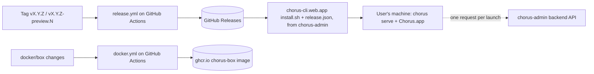

# Infrastructure

What this repo runs on. The website, its installer downloads and the backend API are run from chorus-admin; their
infrastructure, health checks and costs are in that repo's docs, not here.

## Overview

A preview tag updates the rolling `preview` prerelease only; a production tag is published to the website by the release steps
in `AGENTS.md`.

## Components
| Component | Provider | Preview | Production |
|---|---|---|---|
| Release build | GitHub Actions, [`.github/workflows/release.yml`](../../.github/workflows/release.yml) | `vX.Y.Z-preview.N` tag + rolling `preview` prerelease | `vX.Y.Z` tag |
| Downloads | GitHub Releases of `chauvoluuhuong/chorus` | `install.sh --preview` | `install.sh` via the website |
| Box image | GitHub Container Registry, [`.github/workflows/docker.yml`](../../.github/workflows/docker.yml) | see [`features/docker-box.md`](../features/docker-box.md) | same |
| Website, installer, backend | chorus-admin (its `docs/ci-cd.md`) | — | `https://chorus-cli.web.app` |

## Operate
| Check | Command |
|---|---|
| Release builds | `gh run list --workflow release.yml --limit 5` |
| A release's files | `gh release view <tag> --json assets -q '.assets[].name'` |
| Box image builds | `gh run list --workflow docker.yml --limit 5` |
| What users install | `curl -s https://chorus-cli.web.app/release.json` |
| Rollback | revert on `dev`, ship a preview, propose a patch (never move a pushed production tag) |

## Cost
est. $0/month for this repo: GitHub Actions minutes, Releases and ghcr storage are free for a public repo. Website and
backend costs: chorus-admin's docs.
