# Phase 4 e2e proof: Antigravity (agy)

Real `chorus` app, real agy and Claude Code, driven through a PTY (`npm run proof:agy`).
See also the Claude + Codex proof in ../phase4/README.md.

## Result

| | check |
|---|---|
| ✅ | chorus opens on the home screen: agents with versions, and this project's threads |
| ✅ | n opens the new-thread form |
| ✅ | agent: agy, with the models agy lists |
| ✅ | agy opens inside the app |
| ✅ | the sidebar names the thread after the first message |
| ✅ | agy's own permission prompt is detected (sidebar shows !) |
| ✅ | the new-thread form opens |
| ✅ | Claude opens in thread 2 (trust dialog answered) |
| ✅ | thread 2 is in front and agy (thread 1) is still pending |
| ✅ | an approval card for the background agy thread appears over Claude |
| ✅ | at least one agy request was approved from a card |
| ✅ | agy created calc.js |
| ✅ | agy thread finished: waiting dot, store state |
| ✅ | live tailing recorded agy turns, tool calls and usage |
| ✅ | agy artifact notes.md registered |
| ✅ | handoff dialog names the agy thread |
| ✅ | the handoff thread (Claude) appears in front, listed under agy (↳) |
| ✅ | it is a child of the agy thread (claude) |
| ✅ | Claude called get_handoff_context (Chorus saw the MCP call) |
| ✅ | its summary names calc.js |
| ✅ | handoff dialog names the Claude thread |
| ✅ | the agy handoff thread appears in front, listed under the Claude thread it continues (↳) |
| ✅ | it is a child of the Claude thread (agy) |
| ✅ | agy called get_handoff_context (Chorus saw the MCP call) |
| ✅ | its summary names calc.js |
| ✅ | memory view of the agy-continued thread |
| ✅ | artifacts view lists the artifact agy wrote, with its version |
| ✅ | o starts the live preview and shows its address |
| ✅ | the preview page serves what agy wrote and reloads when it changes |
| ✅ | app quits and restores the terminal |

## Screenshots

### 01-home
chorus in a project: the installed agents with their versions, and this project's threads (none yet). n starts one

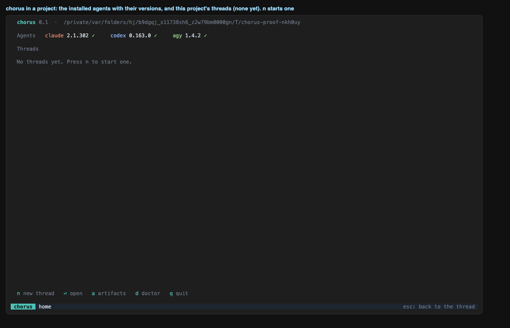

### 02-new-thread-form-agy
chorus starts on the new-thread form: agent agy (model list comes from `agy models`), this folder


### 03-agy-starts
thread 1 is Antigravity CLI (agy); the task was typed into its own screen

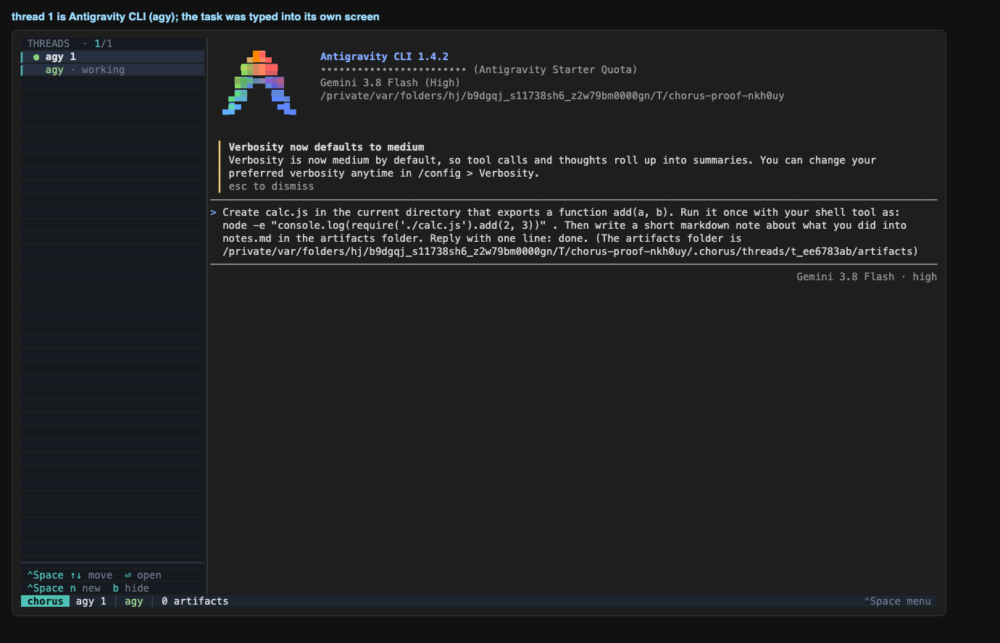

### 04-agy-asks-in-front
agy is in front and asks permission to run a command; the sidebar shows ! for thread 1

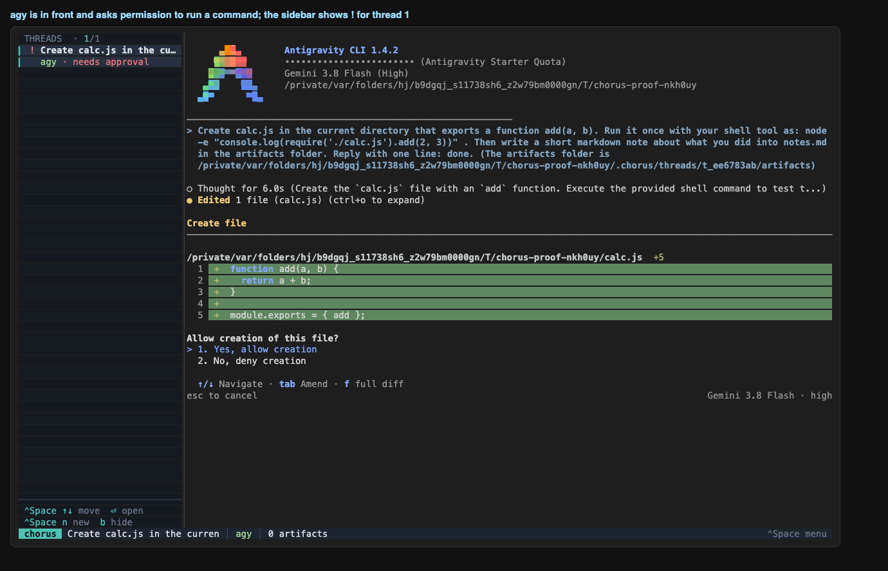

### 05-new-thread-form-claude
ctrl+space n: Claude (default model) in this folder, Enter

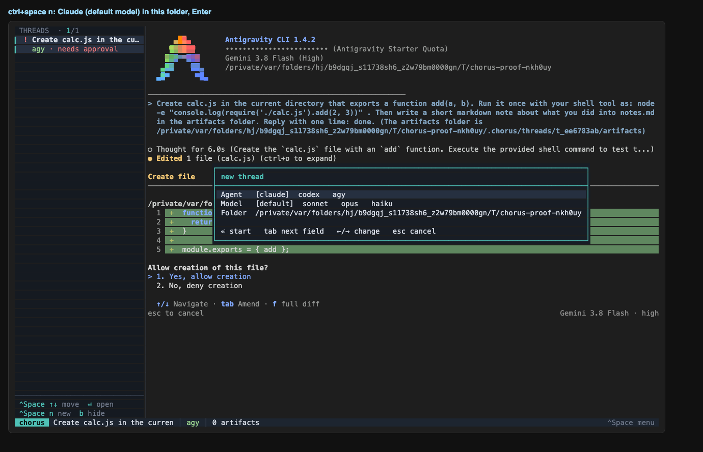

### 06-card-for-agy
Claude is in front; agy (background) is waiting, and Chorus shows its request as a card

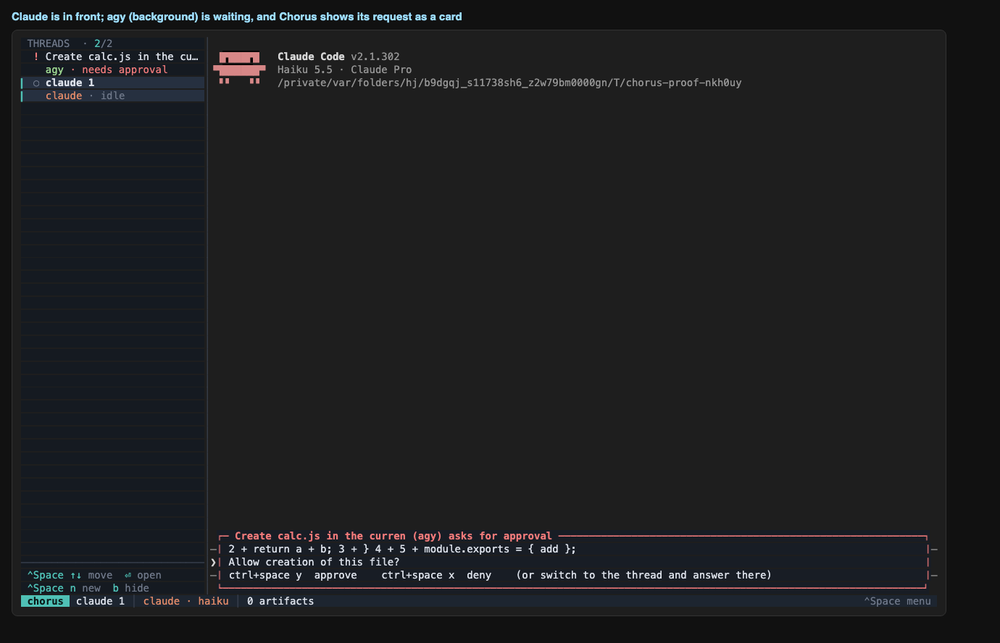

### 07-card-detail
the card shows what agy wants to run and the keys to answer

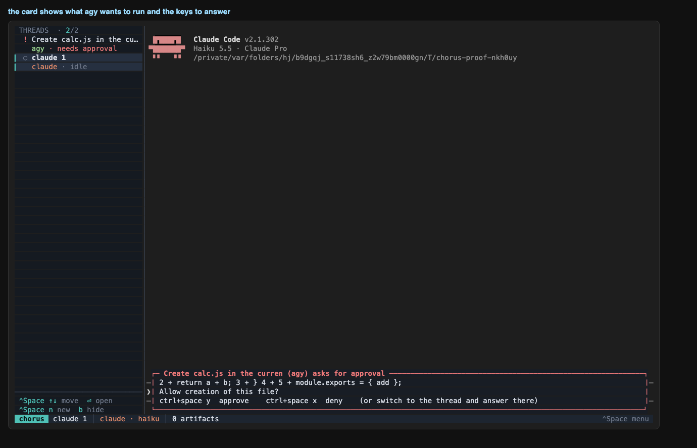

### 08-after-approvals
approved 3 agy request(s) from the card; thread 2 (Claude) stayed in front

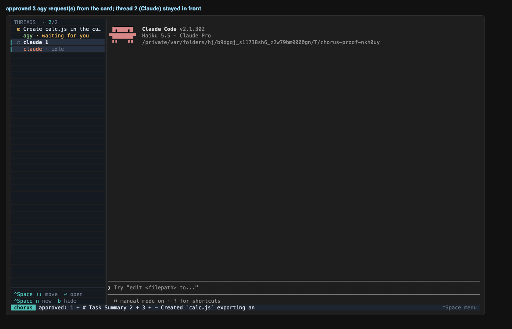

### 09-agy-result
switching to thread 1: what agy did (its own screen, state kept in the background)

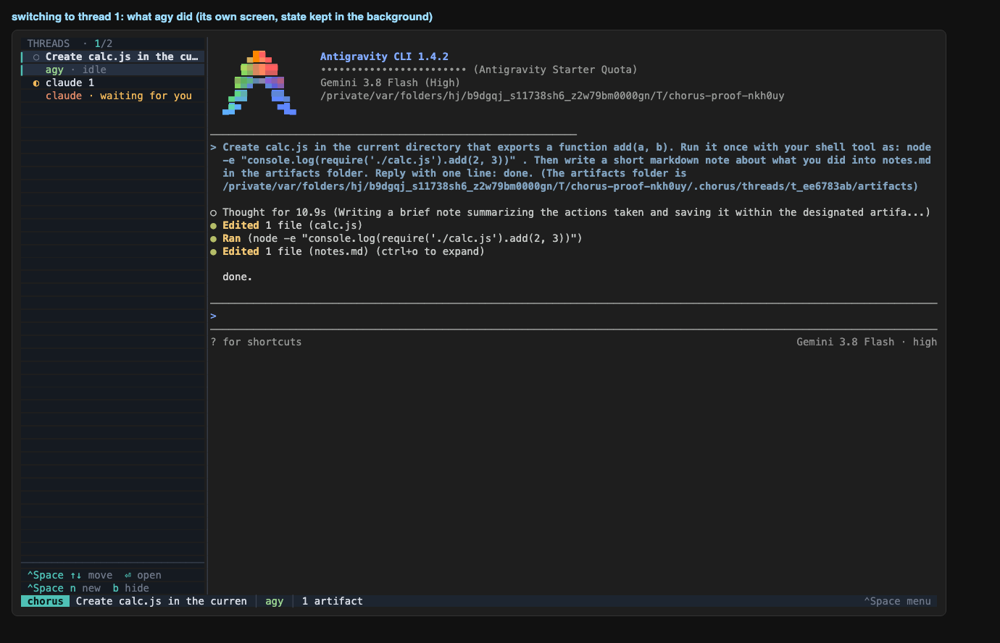

### 10-handoff-dialog-from-agy
ctrl+space h on the agy thread: choose the agent that continues

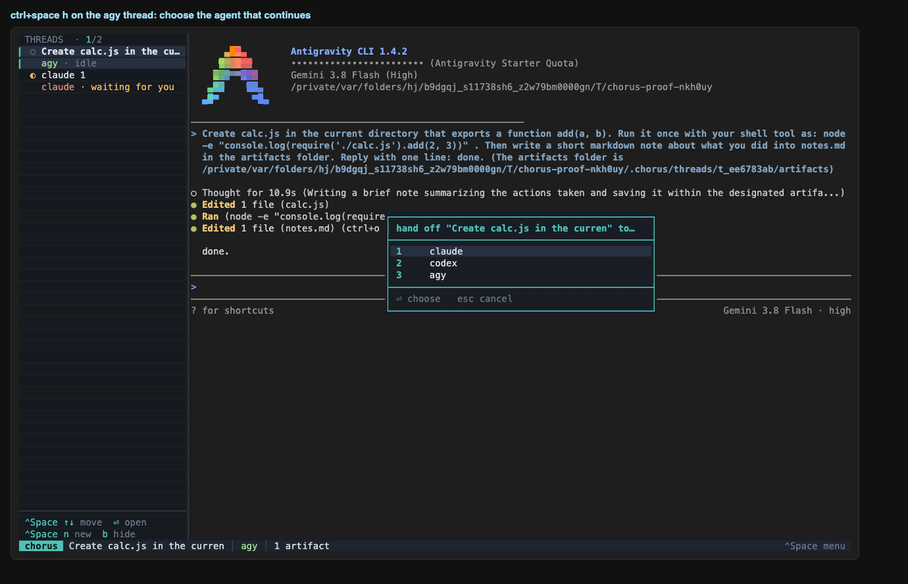

### 11-handoff-agy-to-claude
Claude continues the agy thread: it loaded the context through the Chorus MCP server and summarises it

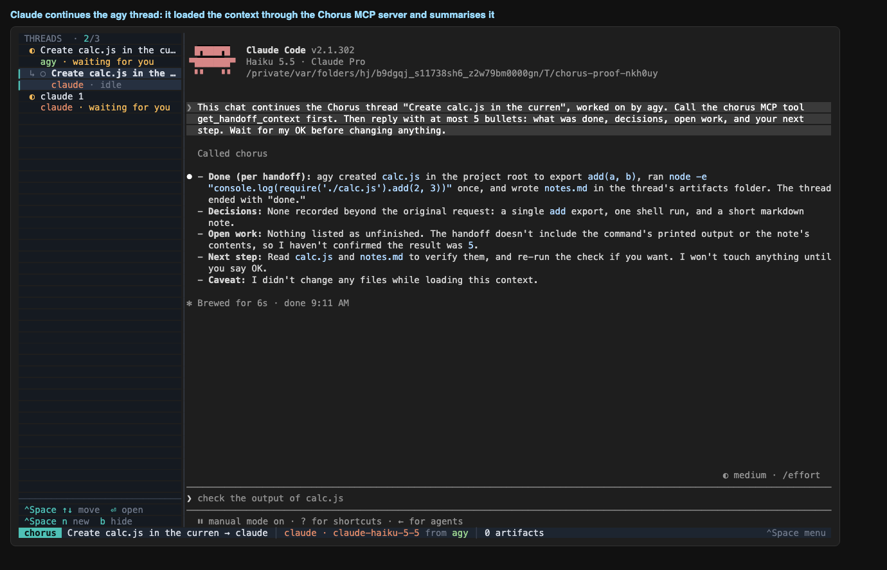

### 12-handoff-claude-to-agy
agy continues the Claude thread (3 approval(s) answered along the way)

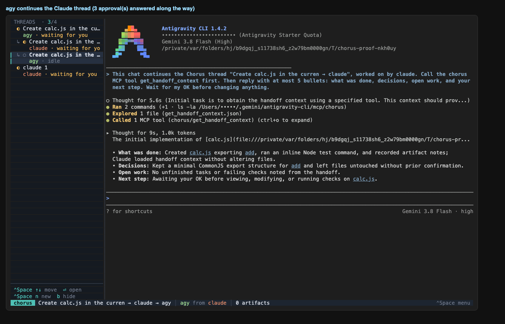

### 13-memory-view
ctrl+space m on the last thread: the digest carried across Claude and agy

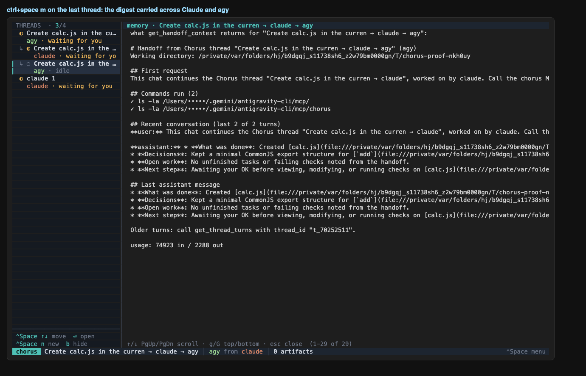

### 14-artifacts-view
ctrl+space a: the artifact agy wrote (name, version, who wrote it)

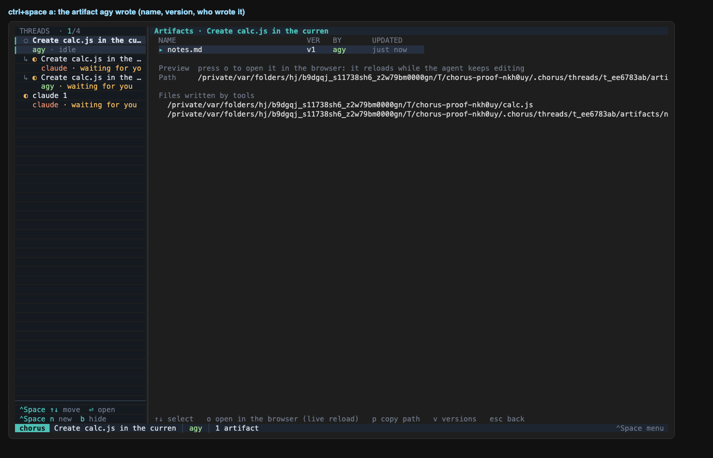

### 15-preview
o: the artifact agy wrote, served at a local address that reloads while the agent keeps editing it

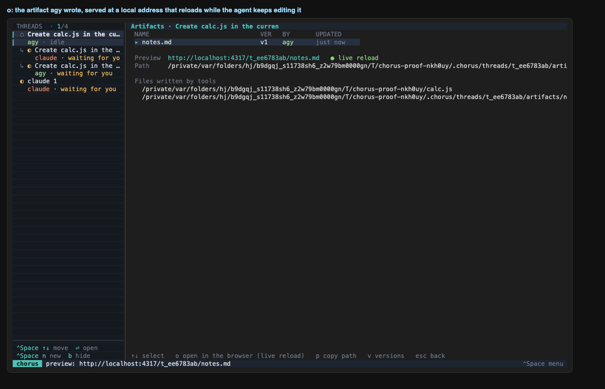

### 16-overview
final state: agy, Claude, the Claude handoff thread and the agy handoff thread

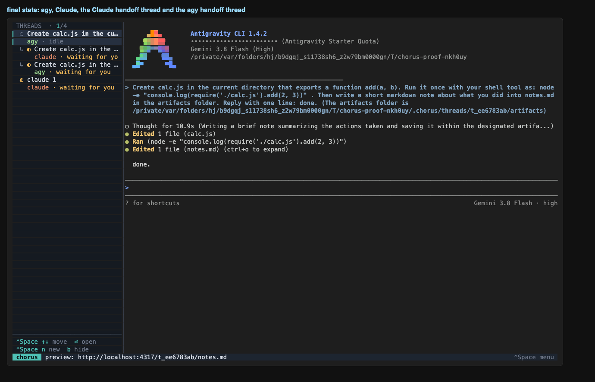

## Commands after the run

```
$ chorus threads
id          agent   state    parent      title
t_70252511  agy     waiting  t_714b2415  Create calc.js in the curren → claude → agy
t_714b2415  claude  waiting  t_ee6783ab  Create calc.js in the curren → claude
t_ee6783ab  agy     waiting  -           Create calc.js in the curren
t_e6856b4e  claude  working  -           claude 1
```

```
$ chorus activity
thread      agent   turns  tools  mcp   tokens in/out     cost     limit
t_70252511  agy     2      4      1     74923/2288        -        -
t_714b2415  claude  2      2      1     28802/654         -        -
t_ee6783ab  agy     2      3      0     58242/1738        -        -
t_e6856b4e  claude  0      0      0     -                 -        -
```

```
$ chorus trace <agy thread>
thread t_ee6783ab (agy ?)
raw terminal capture: $PROJECT/.chorus/threads/t_ee6783ab/raw/pty.log (26069 bytes)
transcript: ~/.gemini/antigravity-cli/brain/eb2ac470-32f0-4c47-9d4b-ceeb8c87c148/.system_generated/logs/transcript.jsonl
transcript lines: 8  → parsed turns: 2, tool calls: 3, status: waiting

last raw lines (cut) → what we made of the session:
  raw  {"step_index":3,"source":"MODEL","type":"PLANNER_RESPONSE","status":"DONE","created_at":"2026-10-18T02:11:31Z","input_tokens":14391,"cache_read_tokens":0,"outpu
  raw  {"step_index":4,"source":"MODEL","type":"GENERIC","status":"DONE","created_at":"2026-10-18T02:11:35Z","content":"Created At: 2026-10-18T09:11:35+07:00\nComplete
  raw  {"step_index":5,"source":"MODEL","type":"PLANNER_RESPONSE","status":"DONE","created_at":"2026-10-18T02:11:37Z","input_tokens":14691,"cache_read_tokens":0,"outpu
  raw  {"step_index":6,"source":"MODEL","type":"GENERIC","status":"DONE","created_at":"2026-10-18T02:11:42Z","content":"Created At: 2026-10-18T09:11:42+07:00\nComplete
  raw  {"step_index":7,"source":"MODEL","type":"PLANNER_RESPONSE","status":"DONE","created_at":"2026-10-18T02:11:43Z","input_tokens":15576,"cache_read_tokens":0,"outpu
  tool ok write_to_file $PROJECT/cal
  tool ok run_command node -e "console.log(require('./calc.js').add(2, 3))"
  tool ok write_to_file $PROJECT/.ch
  turn user: Create calc.js in the current directory that exports a function add(a, b). Run it once with your she
  turn assistant: done.

MCP calls from this thread: none
```

## After the run: card text for agy file changes

The first run showed the last lines of the code in the card. It now names the kind of change and the file; checked on agy's real prompt screen (`fixtures/agy/1.4.2/approval-file`) and Esc was verified to deny it on real agy.

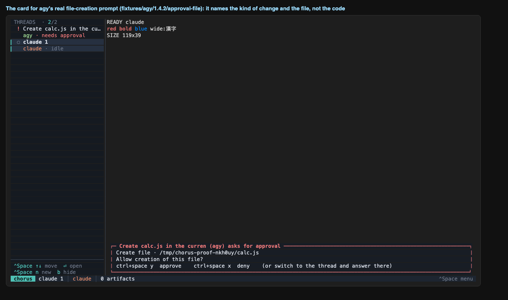
