# Phase 4 e2e proof: Antigravity (agy)

Open `report.html` for the page with the screenshots (`npm run proof:agy` opens it).

## Result

| | check |
|---|---|
| ✅ | chorus opens on the new-thread form |
| ✅ | agent: agy, with the models agy lists |
| ✅ | agy opens inside the app |
| ✅ | the sidebar names the thread after the first message |
| ✅ | agy's own permission prompt is detected (sidebar shows !) |
| ✅ | the new-thread form opens |
| ✅ | Claude opens in thread 2 (trust dialog answered) |
| ✅ | thread 2 is in front and agy (thread 1) is still pending |
| ✅ | an approval card for the background agy thread appears over Claude |
| ✅ | at least one agy request was approved from a card |
| ✅ | agy created calc.js |
| ✅ | agy thread finished: waiting dot, store state |
| ✅ | live tailing recorded agy turns, tool calls and usage |
| ✅ | agy artifact notes.md registered |
| ✅ | handoff dialog names the agy thread |
| ✅ | handoff thread appears as thread 3 |
| ✅ | it is a child of the agy thread (claude) |
| ✅ | Claude called get_handoff_context (Chorus saw the MCP call) |
| ✅ | its summary names calc.js |
| ✅ | handoff dialog names the Claude thread |
| ✅ | the agy handoff thread appears as thread 4 |
| ✅ | it is a child of the Claude thread (agy) |
| ⏭ | agy called get_handoff_context (Chorus saw the MCP call) (not run: agy plan quota reached) |
| ⏭ | its summary names calc.js (not run: agy plan quota reached) |
| ✅ | memory view of the agy-continued thread |
| ✅ | files view lists the agy artifact |
| ✅ | app quits and restores the terminal |

## Screenshots

### 01-new-thread-form-agy
chorus starts on the new-thread form: agent agy (model list comes from `agy models`), this folder


### 02-agy-starts
thread 1 is Antigravity CLI (agy); the task was typed into its own screen

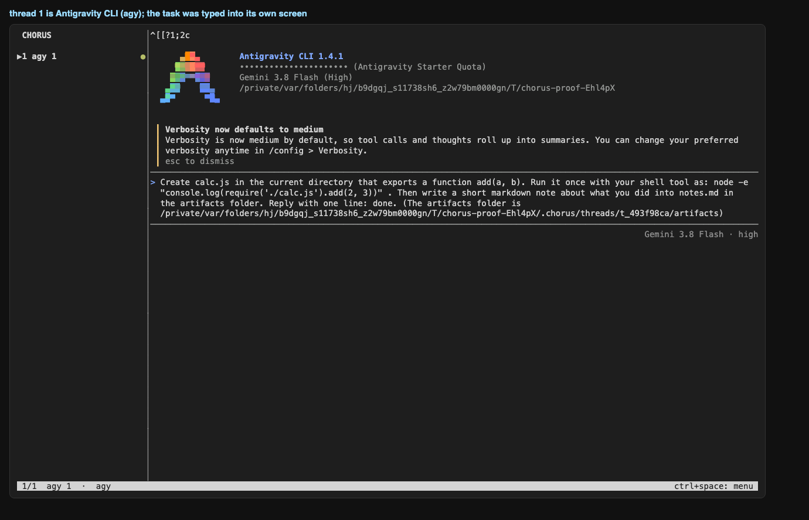

### 03-agy-asks-in-front
agy is in front and asks permission to run a command; the sidebar shows ! for thread 1

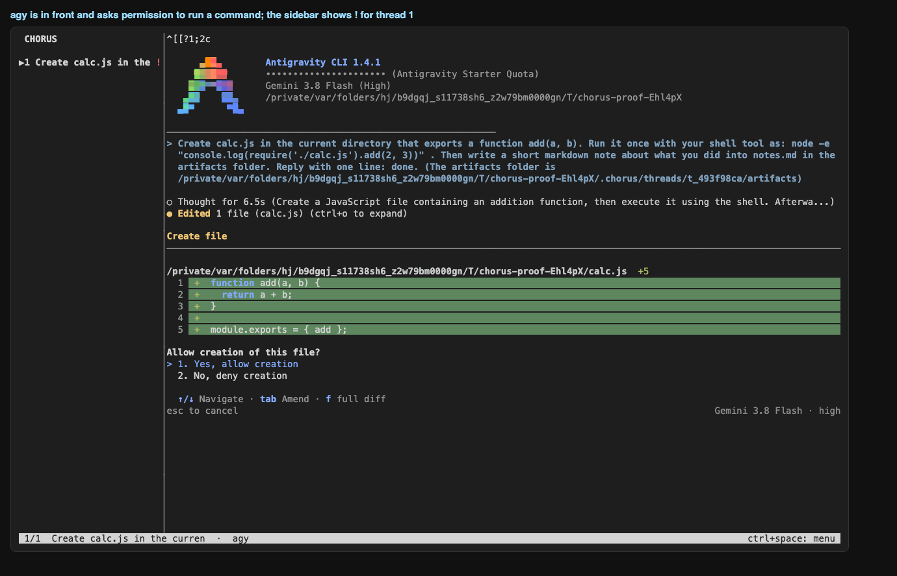

### 04-new-thread-form-claude
ctrl+space n: Claude (default model) in this folder, Enter

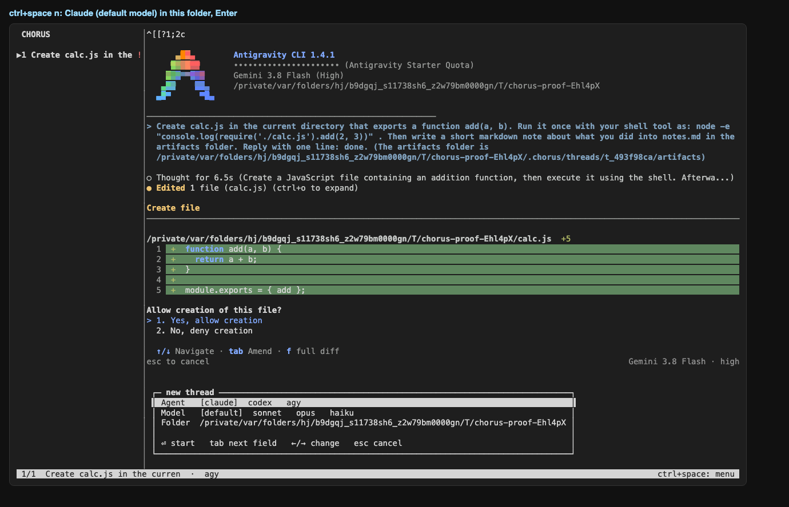

### 05-card-for-agy
Claude is in front; agy (background) is waiting, and Chorus shows its request as a card

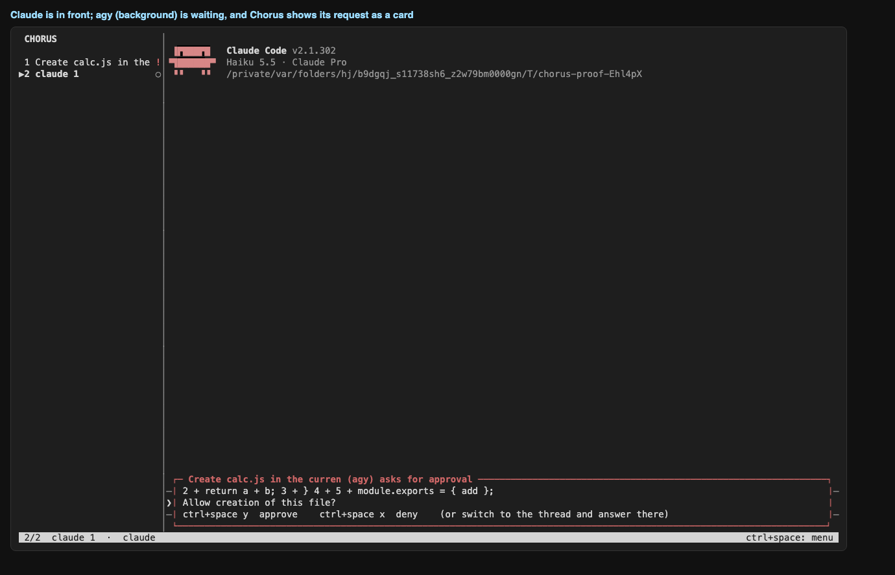

### 06-card-detail
the card shows what agy wants to run and the keys to answer

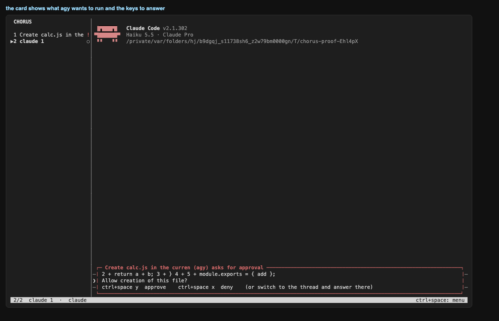

### 07-after-approvals
approved 3 agy request(s) from the card; thread 2 (Claude) stayed in front

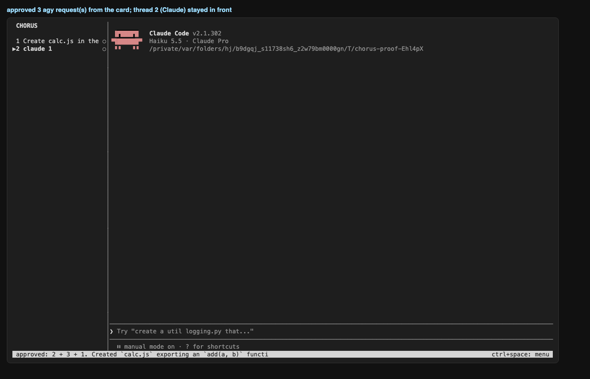

### 08-agy-result
switching to thread 1: what agy did (its own screen, state kept in the background)

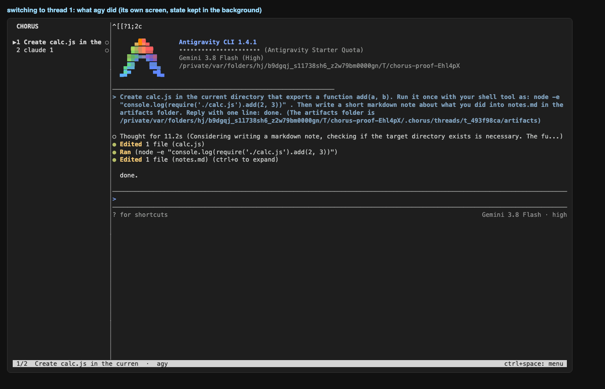

### 09-handoff-dialog-from-agy
ctrl+space h on the agy thread: choose the agent that continues

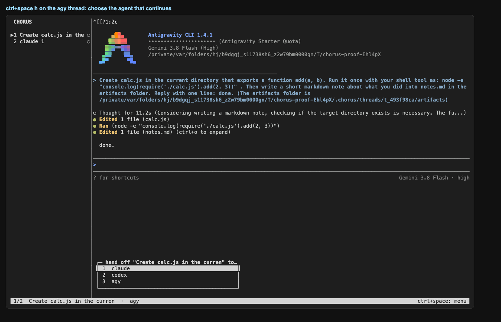

### 10-handoff-agy-to-claude
Claude continues the agy thread: it loaded the context through the Chorus MCP server and summarises it

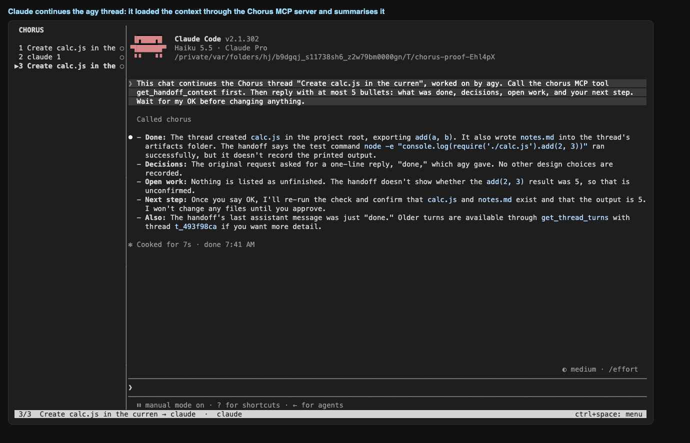

### 11-handoff-claude-to-agy
agy continues the Claude thread (3 approval(s) answered along the way)

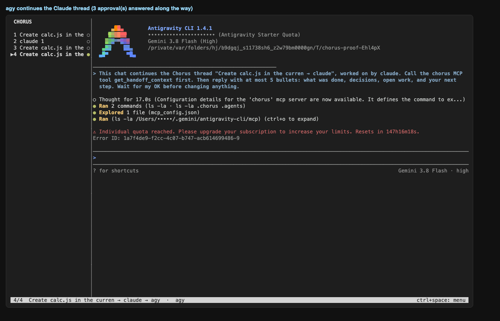

### 12-memory-view
ctrl+space m on the last thread: the digest carried across Claude and agy

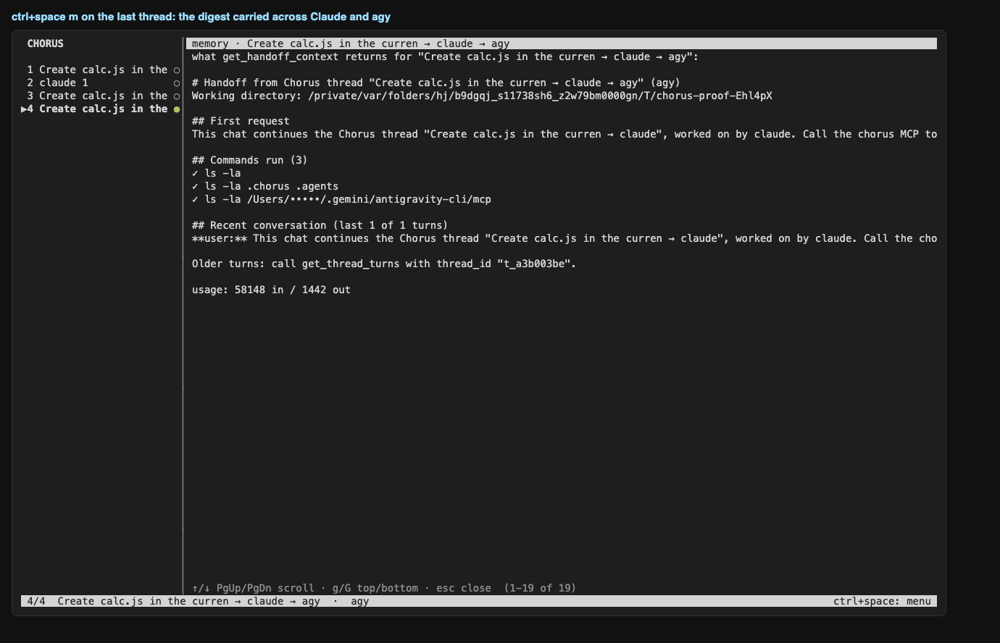

### 13-files-view
ctrl+space f: the artifact agy wrote

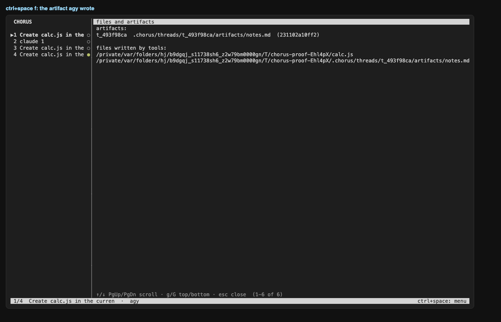

### 14-overview
final state: agy, Claude, the Claude handoff thread and the agy handoff thread

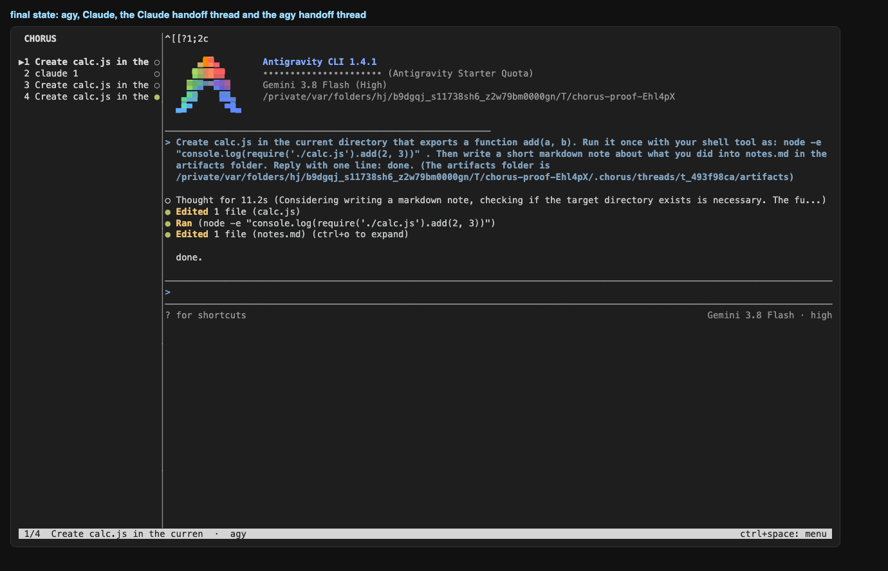

## Commands after the run

```
$ chorus threads
id          agent   state    parent      title
t_a3b003be  agy     working  t_f8005c8e  Create calc.js in the curren → claude → agy
t_f8005c8e  claude  waiting  t_493f98ca  Create calc.js in the curren → claude
t_493f98ca  agy     waiting  -           Create calc.js in the curren
t_c335c497  claude  working  -           claude 1
```

```
$ chorus activity
thread      agent   turns  tools  mcp   tokens in/out     cost     limit
t_a3b003be  agy     1      4      0     58148/1442        -        -
t_f8005c8e  claude  2      2      1     35686/680         -        -
t_493f98ca  agy     2      3      0     60196/1428        -        -
t_c335c497  claude  0      0      0     -                 -        -
```

```
$ chorus trace <agy thread>
thread t_493f98ca (agy ?)
raw terminal capture: $PROJECT/.chorus/threads/t_493f98ca/raw/pty.log (26963 bytes)
transcript: ~/.gemini/antigravity-cli/brain/3066f33c-82b8-46c6-af92-fe49d5009c18/.system_generated/logs/transcript.jsonl
transcript lines: 8  → parsed turns: 2, tool calls: 3, status: waiting

last raw lines (cut) → what we made of the session:
  raw  {"step_index":3,"source":"MODEL","type":"PLANNER_RESPONSE","status":"DONE","created_at":"2026-10-18T00:41:10Z","input_tokens":14984,"cache_read_tokens":0,"outpu
  raw  {"step_index":4,"source":"MODEL","type":"GENERIC","status":"DONE","created_at":"2026-10-18T00:41:13Z","content":"Created At: 2026-10-18T07:41:13+07:00\nComplete
  raw  {"step_index":5,"source":"MODEL","type":"PLANNER_RESPONSE","status":"DONE","created_at":"2026-10-18T00:41:14Z","input_tokens":15278,"cache_read_tokens":0,"outpu
  raw  {"step_index":6,"source":"MODEL","type":"GENERIC","status":"DONE","created_at":"2026-10-18T00:41:19Z","content":"Created At: 2026-10-18T07:41:19+07:00\nComplete
  raw  {"step_index":7,"source":"MODEL","type":"PLANNER_RESPONSE","status":"DONE","created_at":"2026-10-18T00:41:20Z","input_tokens":15878,"cache_read_tokens":0,"outpu
  tool ok write_to_file $PROJECT/cal
  tool ok run_command node -e "console.log(require('./calc.js').add(2, 3))"
  tool ok write_to_file $PROJECT/.ch
  turn user: Create calc.js in the current directory that exports a function add(a, b). Run it once with your she
  turn assistant: done.

MCP calls from this thread: none
```
