# Phase 4 e2e proof

Real `chorus` app, real Claude Code and Codex, driven through a PTY (`npm run proof`).
Each screenshot is the terminal as the user sees it at that step.

## Result

| | check |
|---|---|
| ✅ | Claude opens inside the app |
| ✅ | sidebar shows the thread and the status line the menu key |
| ✅ | the agent's own permission prompt is detected (sidebar shows !) |
| ✅ | new-thread dialog lists the agents |
| ✅ | Codex opens in thread 2 |
| ✅ | thread 2 is in front and Claude (thread 1) is still pending |
| ✅ | an approval card for the background thread appears over Codex |
| ✅ | at least one request was approved from a card |
| ✅ | Claude created calc.js |
| ✅ | Claude thread finished: waiting dot, store state |
| ✅ | live tailing recorded the turns, the node call and the usage |
| ✅ | the artifact notes.md was registered |
| ✅ | Codex answers in its own thread |
| ✅ | handoff dialog names the thread |
| ✅ | the handoff thread appears as thread 3 |
| ✅ | the new thread is a child of the Claude thread in the store |
| ✅ | Codex called get_handoff_context (Chorus saw the MCP call) |
| ✅ | its summary names calc.js |
| ✅ | the handoff thread settles as waiting |
| ✅ | memory view shows what the next agent reads |
| ✅ | tool call view lists the commands |
| ✅ | files view lists the artifact |
| ✅ | app quits and restores the terminal |

## Screenshots

### 01-claude-starts
Chorus app: thread 1 is Claude Code, started with a task

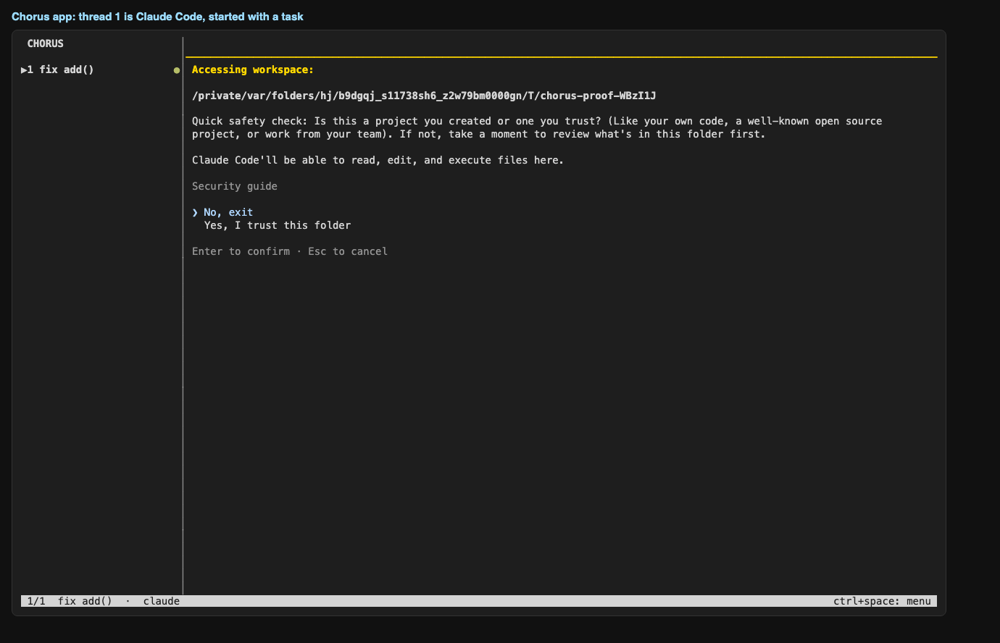

### 02-claude-asks-in-front
Claude is in front and asks permission; the sidebar already shows ! for thread 1

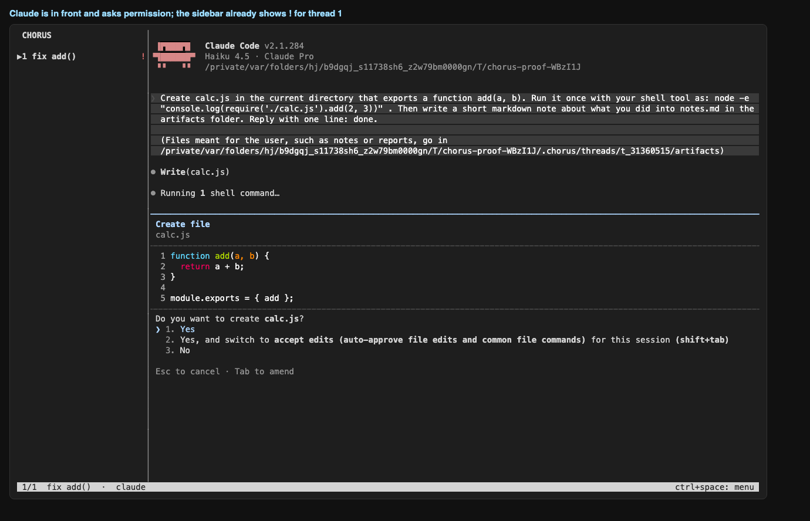

### 03-new-thread-dialog
ctrl+space n: choose which agent to open in a new thread

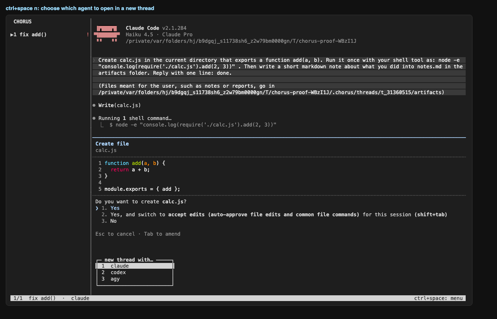

### 04-card-for-background-thread
Codex is in front; Claude (background) is waiting, and Chorus shows its request as a card

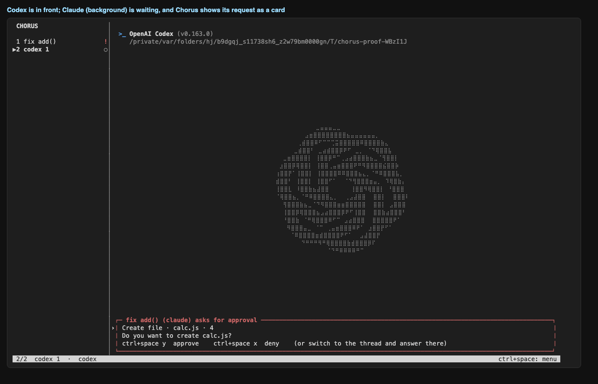

### 05-card-detail
the card names the thread, the command or file, and the key to answer

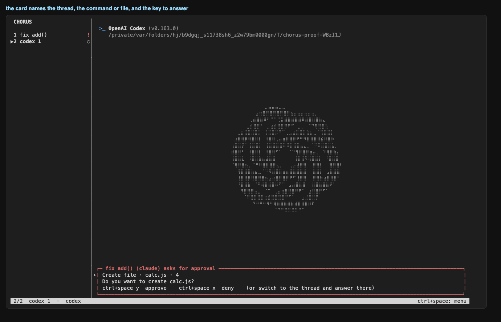

### 06-after-approvals
approved 3 request(s) from the card; thread 2 stayed in front

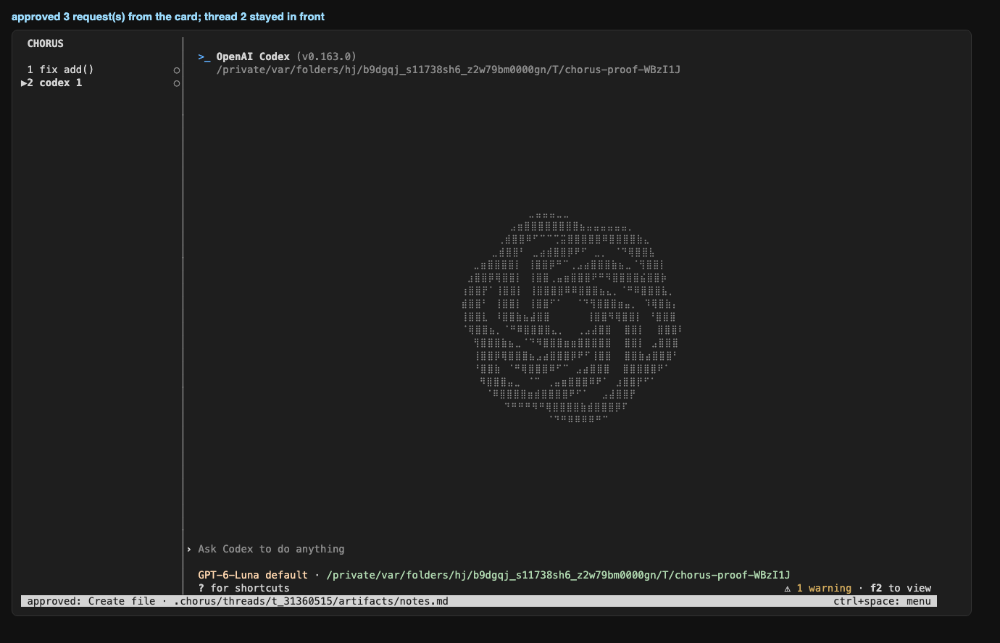

### 07-codex-own-thread
thread 2 (Codex) answers independently while thread 1 is parked in the background

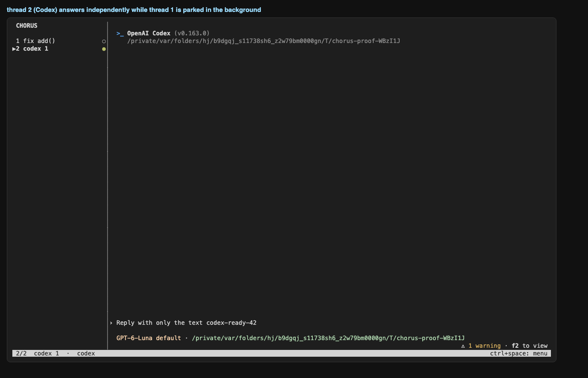

### 08-handoff-dialog
ctrl+space h on thread 1: choose the agent that continues the work

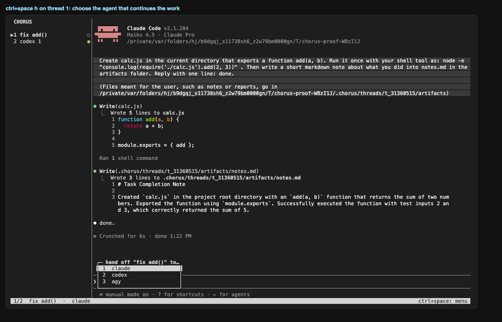

### 09-handoff-summary
the continuing Codex thread loaded the context through the Chorus MCP server and summarises the work

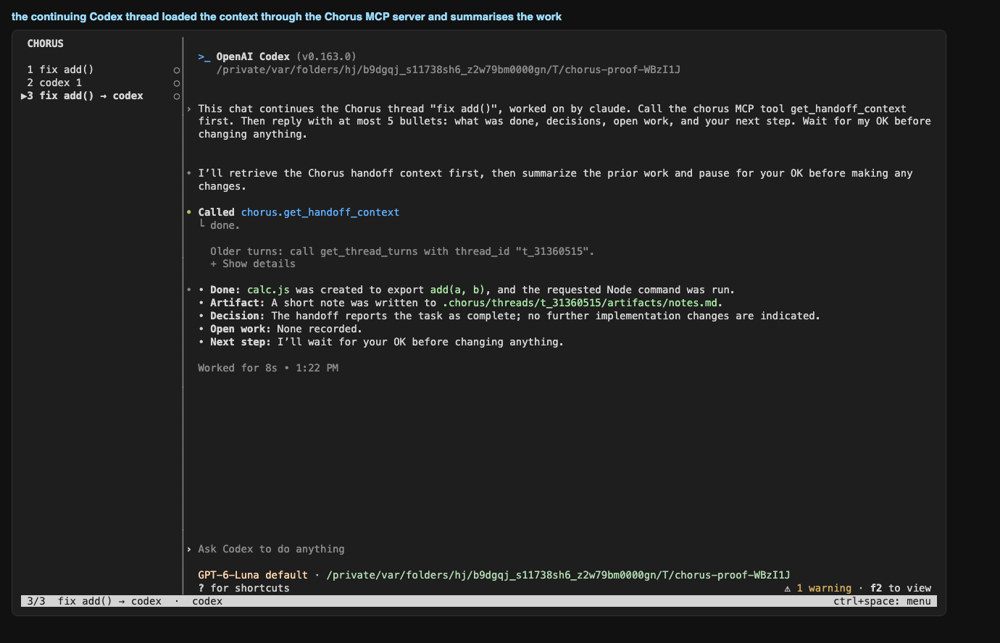

### 10-memory-view
ctrl+space m: the digest a handoff carries (first request, files touched, commands, tests, last message)

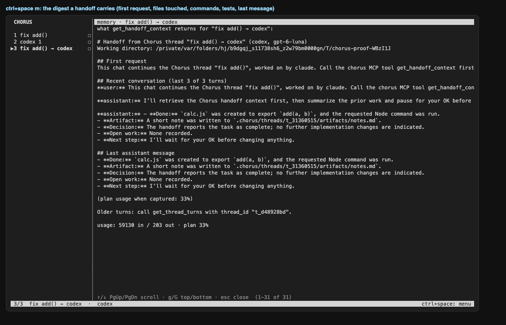

### 11-tool-calls-view
ctrl+space t: every tool call of the thread with status and result

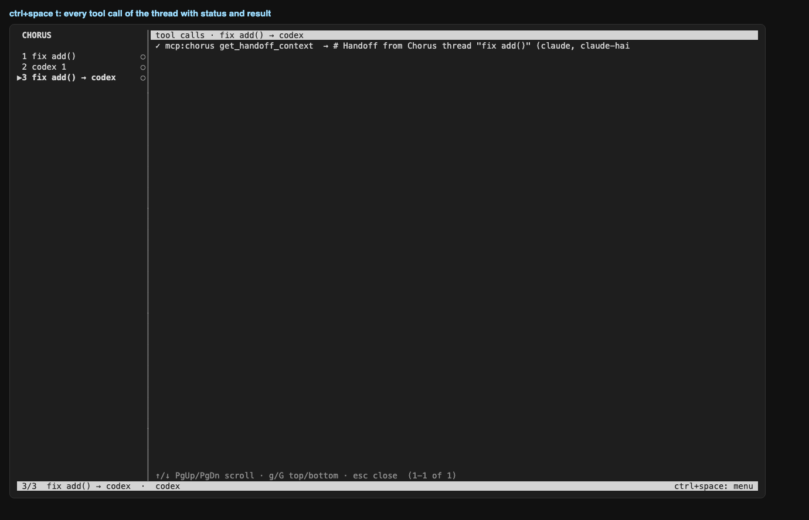

### 12-files-view
ctrl+space f: artifacts per thread and files written by tools

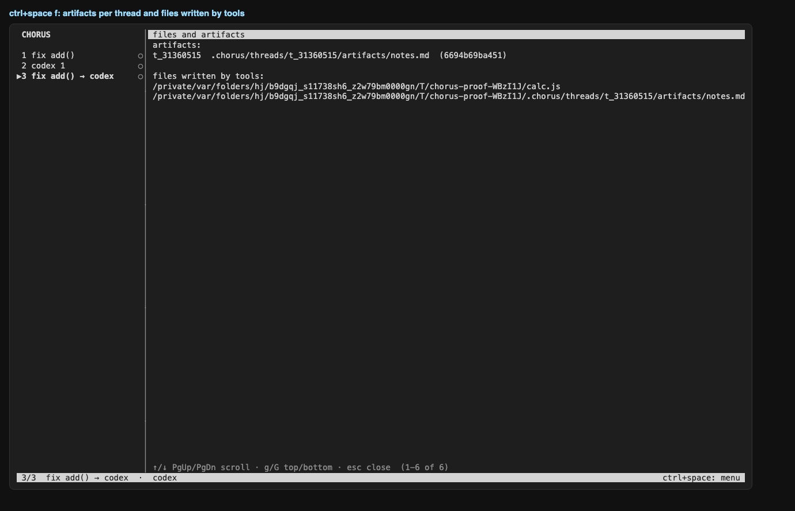

### 13-help-view
ctrl+space ?: the keys

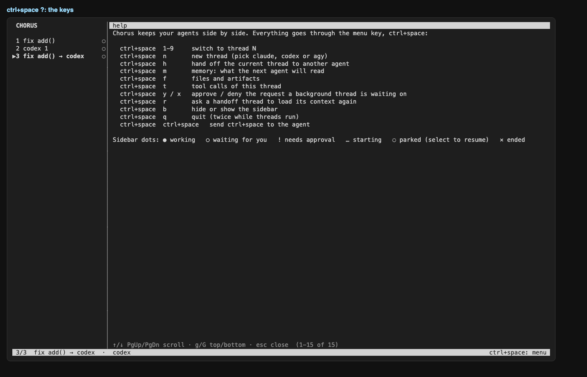

### 14-overview
final state: three threads (Claude, Codex, and the Codex handoff thread), all waiting

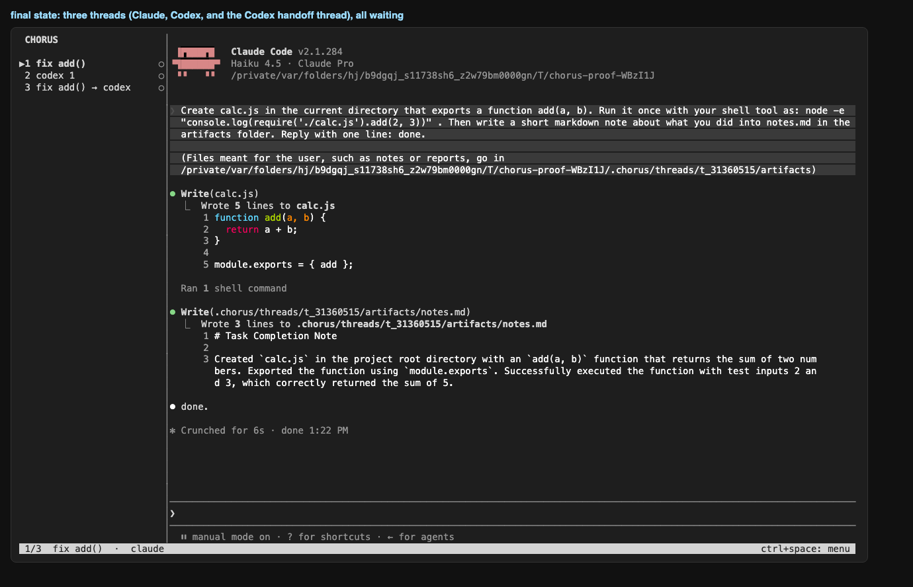

## Commands after the run

```
$ chorus threads
id          agent   state    parent      title
t_d48928bd  codex   waiting  t_31360515  fix add() → codex
t_bac30bfb  codex   waiting  -           codex 1
t_31360515  claude  waiting  -           fix add()
```

```
$ chorus activity
thread      agent   turns  tools  mcp   tokens in/out     cost     limit
t_d48928bd  codex   3      1      1     59130/203         -        33%
t_bac30bfb  codex   2      0      0     19294/9           -        33%
t_31360515  claude  2      3      0     22988/858         -        -
```

```
$ chorus artifacts
t_31360515	6694b69ba451	/private$TMPDIR/chorus-proof-WBzI1J/.chorus/threads/t_31360515/artifacts/notes.md
```

```
$ chorus trace <claude thread>
thread t_31360515 (claude 2.1.284)
raw terminal capture: $PROJECT/.chorus/threads/t_31360515/raw/pty.log (25348 bytes)
transcript: ~/.claude/projects/-private-var-folders-hj-b9dgqj-s11738sh6-z2w79bm0000gn-T-chorus-proof-WBzI1J/59212ad1-99a4-42f2-8e8d-a90173a13cb3.jsonl
transcript lines: 47  → parsed turns: 2, tool calls: 3, status: waiting

last raw lines (cut) → what we made of the session:
  raw  {"parentUuid":"b2a86202-6ae1-439d-854b-7a27b35a4fad","isSidechain":false,"message":{"model":"claude-haiku-4-5-20251001","id":"msg_011Cg7L133rZSD8ySLEJ1GHG","typ
  raw  {"parentUuid":"d41c513e-0cb4-44da-adf3-d34f1417e71c","isSidechain":false,"type":"system","subtype":"turn_duration","durationMs":6952,"messageCount":28,"timestam
  raw  {"type":"cost-state","sessionId":"59212ad1-99a4-42f2-8e8d-a90173a13cb3","totalCostUSD":0.056118400000000006,"totalAPIDuration":8029,"totalAPIDurationWithoutRetr
  raw  {"type":"last-prompt","lastPrompt":"Create calc.js in the current directory that exports a function add(a, b). Run it once with your shell tool as: node -e \"co
  raw  {"type":"cost-state","sessionId":"59212ad1-99a4-42f2-8e8d-a90173a13cb3","totalCostUSD":0.056118400000000006,"totalAPIDuration":8029,"totalAPIDurationWithoutRetr
  tool ok Write $PROJECT/cal
  tool ok Bash node -e "console.log(require('./calc.js').add(2, 3))"
  tool ok Write $PROJECT/.ch
  turn user: Create calc.js in the current directory that exports a function add(a, b). Run it once with your she
  turn assistant: done.

MCP calls from this thread: none
```

```
$ chorus doctor
chorus doctor

node v26.10.0
project: $PROJECT
store: $PROJECT/.chorus/chorus.db (exists)

claude  2.1.284   verified 2.1.301  logged in
        data: ~/.claude
codex   0.163.0   verified 0.163.0  logged in
        data: ~/.codex
agy     1.4.0     verified 1.4.0    has a settings file (no status command; start agy once to sign in)
        data: ~/.gemini/antigravity-cli
```
