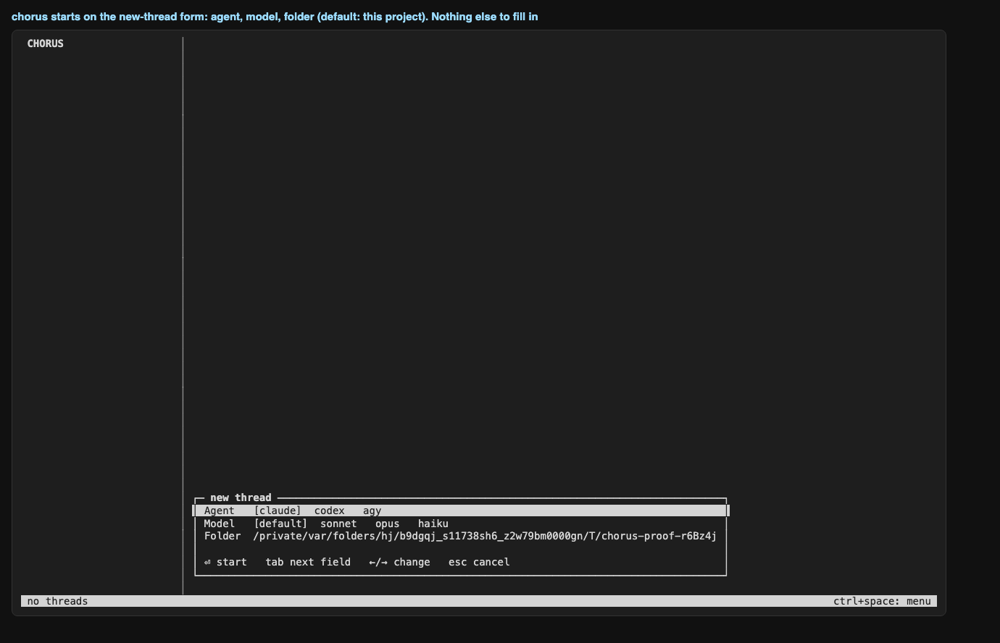
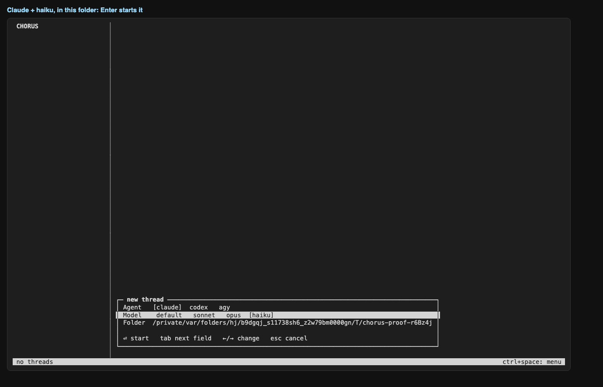
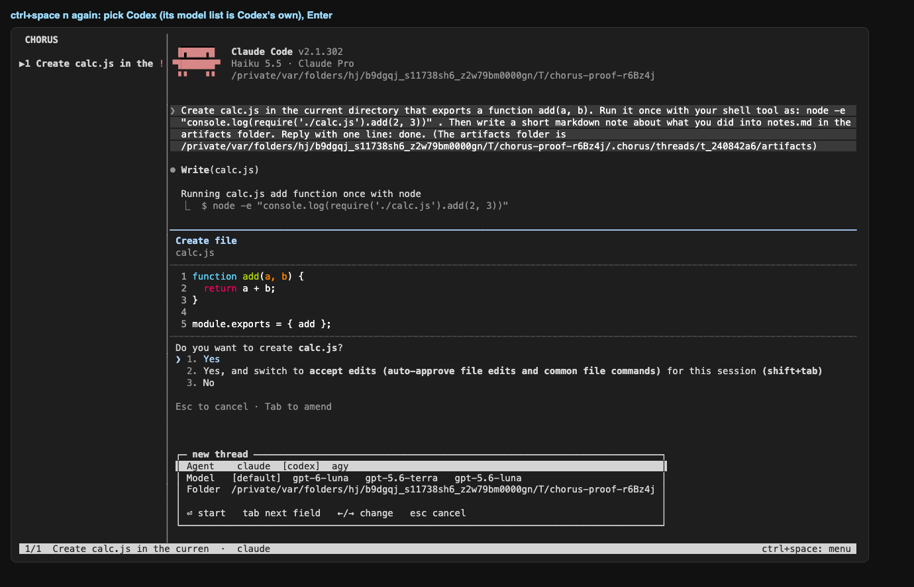
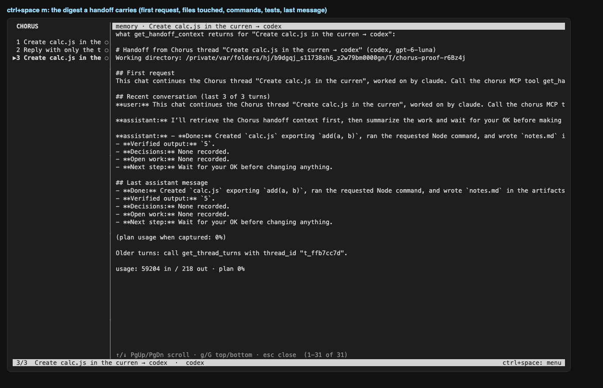
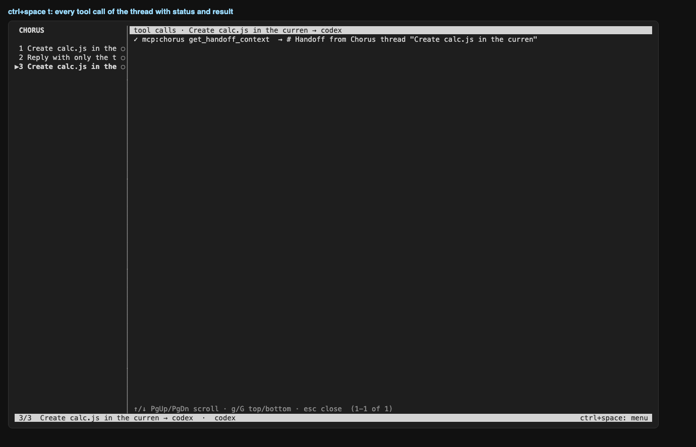
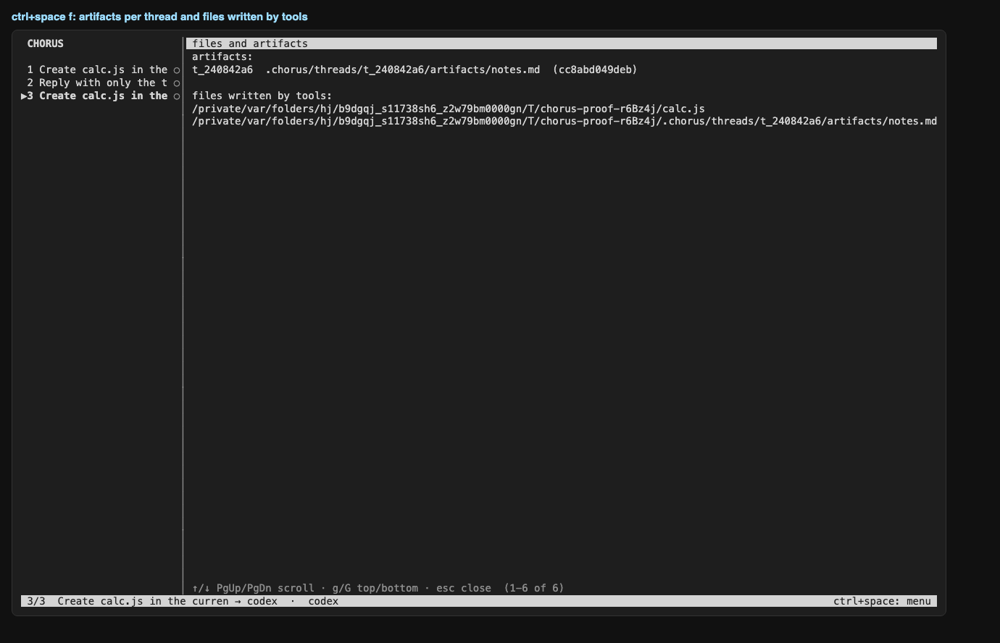
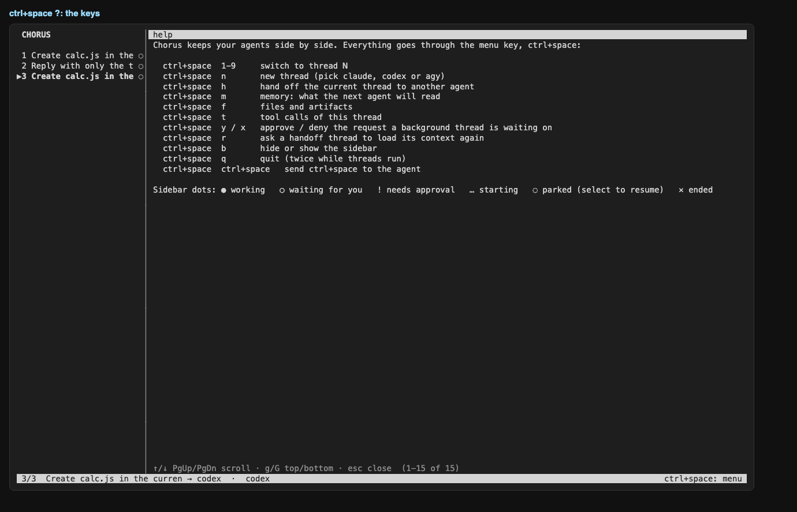
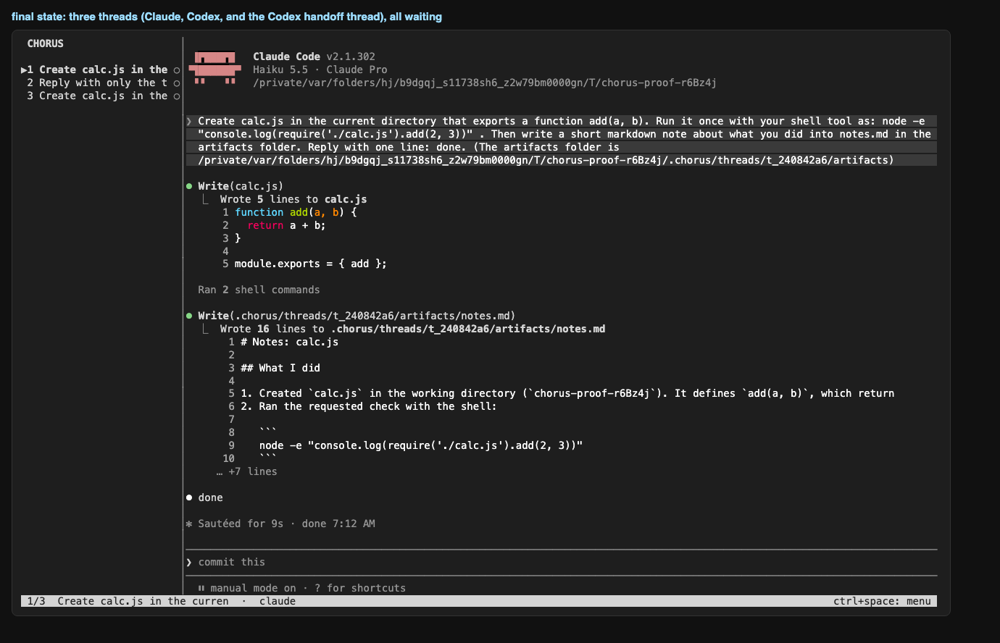

# Phase 4 e2e proof

Real `chorus` app, real Claude Code and Codex, driven through a PTY (`npm run proof`).
Each screenshot is the terminal as the user sees it at that step.

## Result

| | check |
|---|---|
| ✅ | chorus opens on the new-thread form |
| ✅ | the form offers agent, model and the project folder |
| ✅ | model list is Claude's: haiku selected |
| ✅ | Claude opens inside the app |
| ✅ | the sidebar names the thread after the first message |
| ✅ | status line shows the menu key |
| ✅ | the agent's own permission prompt is detected (sidebar shows !) |
| ✅ | the new-thread form opens over the work in progress |
| ✅ | Codex opens in thread 2 |
| ✅ | thread 2 is in front and Claude (thread 1) is still pending |
| ✅ | an approval card for the background thread appears over Codex |
| ✅ | at least one request was approved from a card |
| ✅ | Claude created calc.js |
| ✅ | Claude thread finished: waiting dot, store state |
| ✅ | live tailing recorded the turns, the node call and the usage |
| ✅ | the artifact notes.md was registered |
| ✅ | Codex answers in its own thread |
| ✅ | handoff dialog names the thread |
| ✅ | the handoff thread appears as thread 3 |
| ✅ | the new thread is a child of the Claude thread in the store |
| ✅ | Codex called get_handoff_context (Chorus saw the MCP call) |
| ✅ | its summary names calc.js |
| ✅ | the handoff thread settles as waiting |
| ✅ | memory view shows what the next agent reads |
| ✅ | tool call view lists the commands |
| ✅ | files view lists the artifact |
| ✅ | app quits and restores the terminal |

## Screenshots

### 01-new-thread-form
chorus starts on the new-thread form: agent, model, folder (default: this project). Nothing else to fill in



### 02-new-thread-form-choices
Claude + haiku, in this folder: Enter starts it



### 03-claude-starts
thread 1 is Claude Code (haiku); the task was typed into its own screen


### 04-claude-asks-in-front
Claude is in front and asks permission; the sidebar already shows ! for thread 1


### 05-new-thread-form-codex
ctrl+space n again: pick Codex (its model list is Codex's own), Enter



### 06-card-for-background-thread
Codex is in front; Claude (background) is waiting, and Chorus shows its request as a card


### 07-card-detail
the card names the thread, the command or file, and the key to answer


### 08-after-approvals
approved 4 request(s) from the card; thread 2 stayed in front


### 09-codex-own-thread
thread 2 (Codex) answers independently while thread 1 is parked in the background


### 10-handoff-dialog
ctrl+space h on thread 1: choose the agent that continues the work


### 11-handoff-summary
the continuing Codex thread loaded the context through the Chorus MCP server and summarises the work


### 12-memory-view
ctrl+space m: the digest a handoff carries (first request, files touched, commands, tests, last message)



### 13-tool-calls-view
ctrl+space t: every tool call of the thread with status and result



### 14-files-view
ctrl+space f: artifacts per thread and files written by tools



### 15-help-view
ctrl+space ?: the keys



### 16-overview
final state: three threads (Claude, Codex, and the Codex handoff thread), all waiting



## Commands after the run

```
$ chorus threads
id          agent   state    parent      title
t_ffb7cc7d  codex   waiting  t_240842a6  Create calc.js in the curren → codex
t_e4fc8837  codex   waiting  -           Reply with only the text cod
t_240842a6  claude  waiting  -           Create calc.js in the curren
```

```
$ chorus activity
thread      agent   turns  tools  mcp   tokens in/out     cost     limit
t_ffb7cc7d  codex   3      1      1     59204/218         -        0%
t_e4fc8837  codex   2      0      0     19294/9           -        0%
t_240842a6  claude  2      4      0     38410/1039        -        -
```

```
$ chorus artifacts
t_240842a6	cc8abd049deb	/private$TMPDIR/chorus-proof-r6Bz4j/.chorus/threads/t_240842a6/artifacts/notes.md
```

```
$ chorus trace <claude thread>
thread t_240842a6 (claude 2.1.302)
raw terminal capture: $PROJECT/.chorus/threads/t_240842a6/raw/pty.log (33797 bytes)
transcript: ~/.claude/projects/-private-var-folders-hj-b9dgqj-s11738sh6-z2w79bm0000gn-T-chorus-proof-r6Bz4j/0d99f123-6199-4313-af56-da054dbea930.jsonl
transcript lines: 59  → parsed turns: 2, tool calls: 4, status: waiting

last raw lines (cut) → what we made of the session:
  raw  {"parentUuid":"a0e700af-95f2-4b4b-9478-926198818a95","isSidechain":false,"message":{"model":"claude-haiku-5-5","id":"msg_011Cg8jZp1PcsbfWNFP4aKpL","type":"messa
  raw  {"parentUuid":"47997ad1-3e3f-408f-b427-246deb8e42a1","isSidechain":false,"type":"system","subtype":"turn_duration","durationMs":9781,"messageCount":30,"timestam
  raw  {"type":"cost-state","sessionId":"0d99f123-6199-4313-af56-da054dbea930","totalCostUSD":0.010984840000000001,"totalAPIDuration":11149,"totalAPIDurationWithoutRet
  raw  {"type":"last-prompt","lastPrompt":"Create calc.js in the current directory that exports a function add(a, b). Run it once with your shell tool as: node -e \"co
  raw  {"type":"cost-state","sessionId":"0d99f123-6199-4313-af56-da054dbea930","totalCostUSD":0.010984840000000001,"totalAPIDuration":11149,"totalAPIDurationWithoutRet
  tool ok Write $PROJECT/cal
  tool ok Bash node -e "console.log(require('./calc.js').add(2, 3))"
  tool ok Bash mkdir -p /private/var/folders/hj/b9dgqj_s11738sh6_z2w79bm0000gn/T/chorus-proof-r
  tool ok Write $PROJECT/.ch
  turn user: Create calc.js in the current directory that exports a function add(a, b). Run it once with your she
  turn assistant: done

MCP calls from this thread: none
```

```
$ chorus doctor
chorus doctor

node v26.10.0
project: $PROJECT
store: $PROJECT/.chorus/chorus.db (exists)

claude  2.1.302   verified 2.1.301  logged in
        ⚠ claude 2.1.302 is newer than the last verified 2.1.301; re-run tools/probe and check docs/integrations/claude.md
        data: ~/.claude
codex   0.163.0   verified 0.163.0  logged in
        data: ~/.codex
agy     1.4.1     verified 1.4.0    has a settings file (no status command; start agy once to sign in)
        ⚠ agy 1.4.1 is newer than the last verified 1.4.0; re-run tools/probe and check docs/integrations/agy.md
        data: ~/.gemini/antigravity-cli
```
